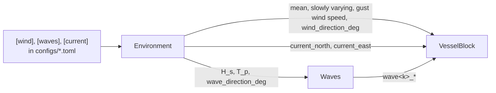

# Environment FMU

One FMU (FMI 2.0 co-simulation, built with pythonfmu 0.7.0, run in OSP) that gives the weather the
vessel sees: wind, sea state and current. Everything is in the earth-fixed **NED frame**, and the FMU
knows nothing about the vessel (no heading input). The vessel FMU turns the wind into relative wind
and loads itself. Owner: Olve.



## 1. Inputs, outputs, parameter

**Parameter**

| Name | Description |
|---|---|
| `config_path` | Path to `configs/*.toml`, set in `OspSystemStructure.xml` |

**Inputs:** none.

**Outputs**

| Name | Unit | To | Description |
|---|---|---|---|
| `mean_wind_speed` | m/s | VesselBlock | V_mean, mean wind speed at the height z, constant |
| `slowly_varying_wind_speed` | m/s | VesselBlock | V_sv, slowly varying part (zero mean) |
| `gust_wind_speed` | m/s | VesselBlock | V_gust, gust part (zero mean) |
| `wind_direction_deg` | deg | VesselBlock | Where the wind comes **from**, clockwise from north, 0–360 |
| `H_s`, `T_p` | m, s | Waves | Significant wave height and peak period, from `[waves]` |
| `wave_direction_deg` | deg | Waves | Where the waves come **from**, clockwise from north |
| `current_speed` | m/s | logging | Current speed |
| `current_direction_deg` | deg | logging | Where the current comes **from**, clockwise from north |
| `current_north`, `current_east` | m/s | VesselBlock | Current velocity components, NED |

The total wind speed V = V_mean + V_sv + V_gust is **not** an output. It is added up where it is used
(in the vessel FMU), so each part can be logged and plotted on its own.

## 2. Model

The wind model follows Sørensen, *Marine Cybernetics: Towards Autonomous Marine Operations and
Systems*, lecture notes, NTNU 2018, section 6.2.2 (`documents/2018-08-20 marcyb.pdf`). The equation
numbers below are from there.

### Wind speed

```
V(t) = V_mean + V_sv(t) + V_gust(t)                                              (6.33)
```

**Mean wind, V_mean.** The mean wind decreases towards the sea surface. It is calculated at the height
z = `reference_height` from the 1-hour mean at 10 m, U10 = `mean_speed`, with a logarithmic profile:

```
V_mean = U10 · 5/2 √κ ln(z / z₀),    z₀ = 10 exp(−2 / (5√κ))                       (6.25)
```

κ = `surface_drag_coefficient` is the sea surface drag coefficient (0.0026 in Sørensen). z = 10 m
gives V_mean = U10. With κ = 0.0026 and U10 = 15 m/s: 12.70 m/s at 3 m and 17.10 m/s at 30 m.

**Slowly varying wind, V_sv.** A first-order Gauss-Markov process, U̇ + μU = w (eq. 6.26, Fossen,
*Handbook of Marine Craft Hydrodynamics and Motion Control*), with μ = 1/T. It is discretised exactly,
so the statistics do not depend on the step size:

```
x[k+1] = a x[k] + σ √(1 − a²) w[k],    a = exp(−dt / T),    w[k] ~ N(0, 1)
```

T is the time constant and σ the stationary standard deviation. The process starts in its stationary
distribution, so there is no start-up transient.

The mean plus the slowly varying part is saturated (eq. 6.27):

```
0 ≤ V_min ≤ V_mean + V_sv ≤ V_max
```

V_min = `min_speed` and V_max = `max_speed`. The saturation is on the state of the process, as a
saturated integrator.

**Gusts, V_gust.** A sum of harmonics from the NORSOK N-003 / ISO 19901-1 (Frøya) wind spectrum, with
random phases (eq. 6.31–6.32). The gusts are about the same at all heights, so the profile is not
used on them; the height enters only through S:

```
V_gust(t) = Σᵢ √(2 S(fᵢ) Δfᵢ) cos(2π fᵢ t + φᵢ)

S(f) = 320 (U₀/10)² (z/10)^0.45 / (1 + f̃ⁿ)^(5/(3n)),    f̃ = 172 f (z/10)^(2/3) (U₀/10)^(−3/4),    n = 0.468
```

U₀ is U10 = `mean_speed` (1-hour mean at 10 m, not V_mean) and z is `reference_height`. The frequencies are spread
logarithmically between `f_min` and `f_max`, and each one is drawn at random inside its band so the
signal does not repeat itself.

**Avoid double counting.** The NORSOK spectrum also covers low frequencies. Keep `f_min` above the
slowly varying band (about 1/(2πT) Hz), or use only one of the two parts.

### Wind direction

```
β(t) = β_mean + rate · t + β_sv(t)
```

- `rate`: a constant turning rate, for a steady veer.
- β_sv: a slow random variation, the same Gauss-Markov process as V_sv (eq. 6.28). Sørensen says
  no saturation is needed here, so there is none.

### Waves and current

Both are constant and passed straight on from the config file. The Waves FMU turns the sea state into
wave components (see [waves_fmu.md](waves_fmu.md)). The current is given as speed and direction in
`configs/*.toml` and sent out both that way and as NED components:

```
current_north = -V_c cos(β_c),    current_east = -V_c sin(β_c)
```

β_c is where the current comes from, like the wind and the waves, so the velocity points the
opposite way.

### Switching parts off

Set the part to 0 in `configs/*.toml`. No rebuild is needed:

| Part | Set |
|---|---|
| All wind | `[wind] enabled = false` (all wind speeds 0) |
| Waves | `[waves] enabled = false` (H_s = 0, calm sea) |
| Slowly varying wind speed | `[wind.slowly_varying] std = 0` |
| Gusts | `[wind.gust] n_components = 0` |
| Direction variation | `[wind.direction_variation] rate_deg_per_s = 0` and `std_deg = 0` |
| Current | `[current] enabled = false` or `speed = 0` |

### Randomness

`[wind] seed` seeds all wind randomness (V_sv, gust frequencies and phases, β_sv). Same seed = the same
wind every run. The waves have their own `seed` in `[waves]`.

## 3. `configs/*.toml`

| Key | Description |
|---|---|
| `[wind] mean_speed` | U10, 1-hour mean wind speed at 10 m [m/s] |
| `[wind] direction_deg` | β_mean, where the wind comes from [deg] |
| `[wind] reference_height` | Height z the wind is calculated for, used in the profile and the spectrum [m] |
| `[wind] surface_drag_coefficient` | κ, sea surface drag coefficient in the height profile [-] |
| `[wind] seed` | Random seed |
| `[wind.slowly_varying] time_constant`, `std` | T [s] and σ [m/s] of V_sv |
| `[wind.slowly_varying] min_speed`, `max_speed` | V_min and V_max, limits on V_mean + V_sv [m/s] |
| `[wind.gust] f_min`, `f_max` | Frequency range of the gusts [Hz] |
| `[wind.gust] n_components` | Number of harmonics |
| `[wind.direction_variation] rate_deg_per_s` | Constant turning rate, clockwise positive [deg/s] |
| `[wind.direction_variation] time_constant`, `std_deg` | T [s] and σ [deg] of β_sv |
| `[waves] hs`, `tp`, `direction_deg` | Sea state, sent on to the Waves FMU |
| `[current] speed`, `direction_deg` | Current speed [m/s] and where it comes from [deg] |

**Changing `configs/*.toml` needs no rebuild.**

## 4. Files

| File | What it does |
|---|---|
| `src/ospfmusim/enviroment/environment.py` | The FMU, everything in one file |
| `tests/test_environment.py` | Tests without OSP: everything switched off gives constant outputs; V_sv has zero mean, the right std and time constant, also with another step size; the gust std matches the NORSOK spectrum; the direction follows mean + rate · t and stays in [0, 360); the current components; the seed; the height profile (U10 at 10 m, the log law); V_mean + V_sv stays inside the saturation limits |

Run from the repo folder:

```
python -m pytest tests/test_environment.py
```

Result with the default config:

| Check | Expected | Result |
|---|---|---|
| V_sv std (T = 300 s, dt = 0.1 s / 1.0 s) | 1.0 m/s | 0.995 / 0.974 m/s |
| V_sv correlation after T | e⁻¹ = 0.368 | 0.366 / 0.356 |
| Gust std (one hour) | 1.395 m/s (spectrum) | 1.373 m/s |
| V_mean at z = 3 / 10 / 30 m (U10 = 15 m/s) | log profile | 12.698 / 15.000 / 17.101 m/s |
| V_mean + V_sv, limits V_mean ∓ 1 m/s, σ = 3 m/s | inside [14, 16] m/s | [14.000, 16.000] m/s |

## 5. Known limitations

- The current is constant: no tidal variation and no depth profile (`current_down` on the vessel is 0).
- The wind is the same everywhere: no spatial coherence over the vessel length.
- The wind direction variation does not change the gust spectrum or the mean speed.
- V_sv uses a time constant T and a std σ. A random walk (μ = 0 in eq. 6.26) is not possible.
- Only the NORSOK gust spectrum is implemented, not the Harris spectrum (eq. 6.30).
- The default parameters (T, σ, f_min, …) are reasonable starting values, not taken from a source.
  Justify them before using the results.
