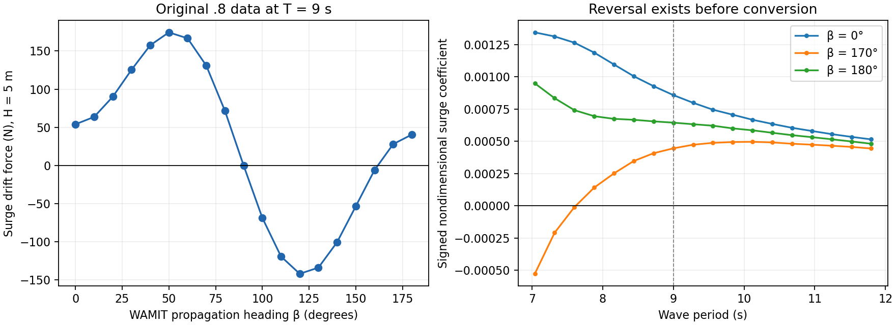

# Gunnerus regular-wave LF drift investigation — 3 November 2026

The reversed near-head-on drift originates in the supplied WAMIT `.8` coefficients. The tested Python loader, angle conversion, mirror, wave-force calculation and built Vessel FMU reproduce those coefficients correctly. No production-code sign or heading change is justified by the evidence. This is a diagnosis of the simulation's cause, not certification that the WAMIT result is physically valid.

For waves FROM 350°, the initial propagation heading is TO 170°. At T=9 s and H=5 m, the model applies X=+27.992461 N, Y=-5.024175 N and N=-11094.723598 Nm. At heading zero, that means northward and westward force, towards the source. The force projected along propagation is -28.439632 N. The original raw coefficient already causes this result.

## Source evidence

The active file is `data_examples/gunnerus2.mat`. Its source prefix identifies `mcmodels/data/vessels/gunnerus/hydro/wamit/processed/converted_runs/run_20261102_191246_135/gunnerus`. The active MAT is byte-identical to that conversion run's `gunnerus2.mat`. The conversion run's `.8` is byte-identical to `wamit/outputs/gunnerus.8`. SHA-256 hashes are saved in the companion JSON.

The `.out` identifies WAMIT 6.413, the low-order method, Gunnerus27.gdf, 2090 unknowns, 4180 full-hull panels, 164 waterline panels, Y=0 symmetry, infinite depth, ULEN=1 m, density 1025 kg/m³ and g=9.80665 m/s². XBODY/YBODY/ZBODY/PHIBODY are all zero. The `.pot` requests 100 periods from 2 s in 0.28 s increments and headings 0:10:180. Thus **9 s is an exact source node**, not an interpolation artefact.

Signed real surge entries from column 7 of the original `.8`:

| Raw WAMIT propagation β | Coefficient at 9 s | Converted surge N/m² | Surge at H=5 m |
|---:|---:|---:|---:|
| 0° | +0.0008588509 | +8.633011 | +53.956321 N |
| 10° | +0.001012664 | +10.179112 | +63.619453 N |
| 170° | +0.0004455706 | +4.478794 | +27.992461 N |
| 180° | +0.0006450965 | +6.484391 | +40.527447 N |
| 350° | not supplied directly; mirror of 10° | +10.179112 | +63.619453 N |

At 4.8 s, raw surge at 170° is **-0.9330406**, and at 180° it is **-0.9523749**. At 9 s both are positive. A fixed axis inversion or extra 180° shift cannot explain this period-dependent behaviour. Both 0° and 180° raw surge values are positive at 9 s: swapping those headings cannot restore opposite signs.

The exact head-on case is therefore also affected: waves FROM 0° produce TO 180° and +40.527447 N northward force. The earlier impression that all cardinal headings are correct does not hold for these data and this period. Beam-wave cases have large sway in the expected propagation direction, which can make them look reasonable.

## Verified data path and conventions

1. Saved TOML gives environmental directions **FROM**, clockwise from north. Environment sends wave direction, height and period to Waves.
2. `waves/waves.py` calls `directions_to(..., direction_is_from=True)`: add 180° and wrap once. Regular wave amplitude is H/2, frequency is 2π/T; only the first of 100 components is active.
3. Each saved OSP XML has all 400 Waves→Vessel component connections matched by name. Vessel accepts degrees and converts to radians; it does not add another 180°.
4. The load model uses relative propagation heading `direction - LF yaw`. Body axes are forward/starboard/down; earth axes north/east/down.
5. WAMIT β is a **propagation** angle, counterclockwise about the upward axis. The geometric transformation FPU→FSD is diag(+1,-1,-1). A source beta must therefore change sign. For the symmetric hull, expressing the negative heading through positive stored headings introduces the additional reflection signs. The converter's `T_rao=[+1,+1,-1,-1,-1,+1]` combines those two operations. Its X,Y,N signs are all +1 on stored 0..180; this is consistent, not a missing y-axis flip.
6. In `wamit2vessel.m`, drift uses the **signed real column**, not the positive modulus. Scaling is ρg·ULEN for force per amplitude squared and ρg·ULEN² for moment. No 180° shift is applied there. The dimensional scale here is 10051.81625. The entire 100×19×3 raw grid matches the loaded values numerically.
7. For 190..350, mirror 170..10 with signs [+1,-1,-1] on X,Y,N. The active MAT already has 36 columns, so `_wamit_motion.py` does not mirror it again. A separate regression truncates to 19 columns and verifies the legacy expansion reproduces the full table.
8. `newman` and the current signed `newman_absolute` both reduce to **a²T** for one regular-wave component. Tests cover both signs and both periods at multiple times. The name “absolute” does not mean the final force is made positive in the present implementation. Switching these methods cannot cure this case.
9. Vessel passes `tau_second_order` to LF exactly once. First-order forces are diagnostics; WF displacement is calculated separately and added to published total pose. The mean diagnostic is not added a second time.
10. LF solves M·ν̇=applied forces minus the other terms. Its body→NED rotation is conventional. Tests verify force balance at rest, signed surge acceleration, rotation invariance, and continuity on either side of the heading-grid nodes, including 0/360.

WAMIT Option 8 forces are in global coordinates, whereas other drift methods can use body coordinates. This dataset has PHIBODY=0, so that distinction does not introduce an unaccounted rotation here. The mesh also supports a +x bow interpretation: near the positive-x waterline tip the half-width is under 0.8 m, while the negative-x end is over 4.6 m wide. There is no evidence for a 180° model orientation correction. This geometric check is not a replacement for the original model's orientation documentation.

## Saved runs

All three runs use regular H=5 m, T=9 s waves, the same active MAT path, wind disabled, current disabled, and thrust allocation disabled. Logged ambient wind and delivered thruster forces are zero. Small nonzero `wind_X` is relative-air drag from vessel motion in still air, not an enabled wind disturbance.

| Run | Waves FROM | Duration | Final LF north | Final LF east | Final LF yaw |
|---|---:|---:|---:|---:|---:|
| 20261103_140110 | 10° | 2000 s | +107.458 m | +18.8761 m | +0.0111364 rad |
| 20261103_132738_check_yaw_waves_1 | 350° | 2500 s | +167.454 m | -30.2583 m | -0.351273 rad |
| 20261103_133956_check_yaw_wind_1 | 350° | 2500 s | +167.454 m | -30.2583 m | -0.351273 rad |

The “wind” name is misleading. Recalculation at sampled logged LF headings reproduces X,Y,N drift with maximum absolute errors under 0.00015 N, 0.000028 N and 0.077 Nm, respectively. These differences are consistent with the logs' rounded frequencies, headings and forces. The two 350° cases have identical reported endpoints and sampled force errors.

The fresh seven-FMU OSP replay completed all 2000 seconds. Its 20,001 logged rows match `20261103_140110` exactly for Time, LF north, LF east, LF yaw and X/Y/N wave drift. This is an end-to-end numerical reproduction with the current implementation, not merely a pinned-force check. The completed evidence is in `results/forensic_replay_20261103_140110_complete` and the companion JSON. The first attempt was terminated at about 1771.5 seconds; the persistent retry completed normally. Numerical-library thread counts were set to one for the retry; no physical settings were changed.

The selected MAT contains explicit **M/D/G** matrices. `Wamit.py` selects these, ahead of the otherwise automatic low-frequency B+Bv construction. Stored D has only roll damping, D44=1,000,000; surge, sway and yaw damping are zero. The nonzero 3×3 damping matrix written elsewhere in TOML is for the controller, not the hull's LF model. This explains why tens of newtons can produce substantial displacement over thousands of seconds. It does not explain or correct their sign. Adding calibrated damping may improve motion realism but would conceal rather than validate the questionable drift direction if used as a sign fix.

## Physics versus numerical validity

A drift coefficient is a signed force or moment component per squared wave amplitude after dimensionalization. An individual component need not always follow the corresponding component of the incident direction. Nevertheless, this dataset gives negative force projected on propagation at near-head-on 9-second conditions, including exactly head-on. That is a strong reason to validate the hydrodynamic solution, not to declare upstream drift physically established.

The source coefficient is small, the numerical result involves radiation/diffraction contributions, and no independent pressure/control-surface drift output or mesh-convergence series is present in this WAMIT directory. IRR=0 is recorded. There is no evidence here sufficient to identify a particular WAMIT solver, mesh, quadrature, or motion-response error as the proven cause. Nor does a smooth frequency curve establish convergence. The original `.out` also reports the positive coefficient, so it is not a text-parser artefact.

Required follow-up, keeping the baseline immutable:

- Rerun the same mesh and exact FRC mass, CG and damping at T=4.8, 8.72, 9.0 and 9.28 s, with beta 0,10,170,180 (and direct 190/350 if the workflow permits). Save `.out`, `.8`, run log and all actual inputs.
- Compare signed X,Y,N from momentum `.8` with pressure `.9` and a control-surface calculation (the corresponding WAMIT 6.4 control-surface option, not blindly copying a version-7 option number).
- Repeat on at least two systematically refined meshes, especially the waterline and bow/stern; compare signed values and absolute changes, not only percent changes near zero. For beta170 at T9, seek absolute coefficient differences much smaller than 0.0004456; a practical initial target is below 0.00004 with consistent sign across methods.
- Increase MAXMIT gradually from its default to check azimuthal momentum integration; inspect warning/log output. Mesh refinement is still required even if this quadrature check passes. Check IRR treatment and the motion solution consistently, and compare Haskind/direct force outputs where available. Current metadata records a force/motion-method mismatch; the first-order diagnostic mismatch is not what generates the LF sign, but agreement is a useful hydrodynamic cross-check.
- Verify original model orientation, displacement, mass/CG, roll damping and physical LF damping against the intended Gunnerus loading condition. Do not infer missing damping from the observed reversed track.

Authoritative definitions: [WAMIT 6.4 quantities and drift definitions](https://www.wamit.com/manual6.4/Chap4.pdf), [WAMIT 6.4 inputs and MAXMIT](https://www.wamit.com/manual6.4/Chap3.pdf), [WAMIT propagation-heading definition](https://www.wamit.com/manual7.x/html/wamit_v75manualch4.html), and [drift methods/global axes](https://www.wamit.com/manualv7.4/wamit_v74manualch3.html). The version-7 references clarify shared conventions; the actual source run is version 6.413.

## Changes and reproduction

No production source, configuration, original WAMIT data, or MAT data was changed in this investigation. Existing uncommitted edits in both repositories were preserved. Added:

- `tests/test_gunnerus_drift_forensics.py`: 34 passing regression cases, including six calls through the actual built Vessel FMU.
- `scripts/audit_gunnerus_drift.py`: read-only raw/source and saved-force audit; writes the companion JSON.
- This report, JSON evidence and source-coefficient figure.
- A separate fresh OSP replay directory, `results/forensic_replay_20261103_140110_complete`. An earlier interrupted attempt remains separately in `results/forensic_replay_20261103_140110` and is not a completed run.

From the ospdpsimpy repository, run `PYTEST_DISABLE_PLUGIN_AUTOLOAD=1 .venv/bin/python -m pytest -q tests/test_gunnerus_drift_forensics.py`. The environment flag avoids an unrelated ROS pytest-plugin import failure (missing PyYAML). Run `.venv/bin/python scripts/audit_gunnerus_drift.py` to regenerate the numeric evidence. The tests require this real MAT, the sibling mcmodels `.8` (override with GUNNERUS_WAMIT8), and the built Vessel FMU for the integration cases.

The broader selected suite returned 78 passed, 7 skipped, 5 failed, plus 2 passing subtests before the seven additional boundary checks were added. All five failures were in existing `test_wamit_autodetect.py`: it assumes a 100-frequency fixture and particular array dimensions for `GunnerusL35_20201112.mat`, but that local file has 36 frequencies and different Bv/speed dimensions. They are not failures of the active gunnerus2.mat regression. No existing test was altered to hide these failures.

Historical limitation: saved runs retain config/XML/CSV, not immutable copies of every FMU/source/MAT. Current source reproduces their sampled load calculations, but exact historical source identity cannot be proved from those directories alone. The active built FMUs used by the system carry the current WaveLoads implementation; an older unused ThrusterDynamics.fmu exists, while the configured system uses ThrusterDynamicsKtKq.fmu.
